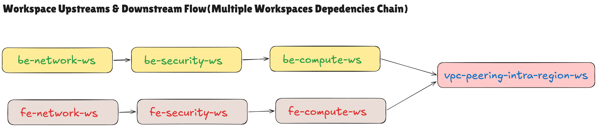
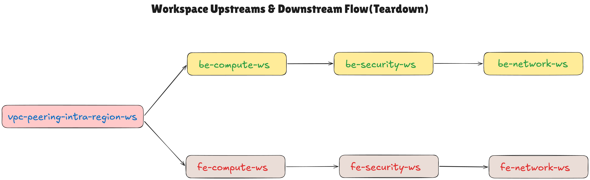

# Intra-Region VPC Peering and Terraform State Refactoring Lab

A Terraform proof of concept that connects two VPCs in **Singapore (`ap-southeast-1`)** while restricting cross-VPC communication to selected private subnet pairs and security groups.

The lab combines **explicit routing**, **controlled inbound and outbound traffic**, and **separate Terraform states**. A dedicated controller coordinates the creation and destruction of seven dependent HCP Terraform workspaces.

## Contents

- [Architecture](#architecture)
- [Infrastructure Overview](#infrastructure-overview)
- [Explicit Routing Policy](#explicit-routing-policy)
- [Security Controls](#security-controls)
- [Connectivity Verification](#connectivity-verification)
- [Why Refactor Terraform State?](#why-refactor-terraform-state)
- [Workspace Layout and Output Sharing](#workspace-layout-and-output-sharing)
- [Workspace Orchestration](#coordinating-creation-and-destruction-across-multiple-dependent-workspaces-with-tfe_workspace_run)
- [Running the Lab](#running-the-lab)
- [Teardown](#teardown)
- [Implementation Notes](#implementation-notes)
- [References](#references)

## Architecture


[Open the full-resolution infrastructure diagram](assets/intra-region-vpc-peering.png) to inspect the routing entries, security rules, and terminal captures.

Both VPCs are in the **same AWS Region**. The architecture is intra-region peering, even though the original source image was named `VPC-Inter-Region-Peering.png`.

## Infrastructure Overview

| Component | Frontend | Backend |
| --- | --- | --- |
| AWS Region | Singapore, `ap-southeast-1` | Singapore, `ap-southeast-1` |
| VPC CIDR | `10.0.0.0/16` | `192.168.0.0/16` |
| Public subnets | Three /24 subnets | Three /24 subnets |
| Private subnets | Three /24 subnets | Three /24 subnets |
| Public instance | One Amazon Linux 2023 bastion in public subnet 01 | One Amazon Linux 2023 bastion in public subnet 01 |
| Private instances | Three Ubuntu 24.04 instances, one per private subnet | Three Ubuntu 24.04 instances, one per private subnet |
| Default instance type | `t3.micro` | `t3.micro` |
| Internet access | Internet Gateway for public subnets; regional NAT gateway for private subnet 01 | Internet Gateway for public subnets; regional NAT gateway for private subnet 01 |
| Peering role | Requester | Accepter |

Each public bastion has an Elastic IP. Private instances use private addresses. Public subnets 02 and 03 are provisioned but have no EC2 instances in the current configuration.

The peering connection enables remote VPC DNS resolution on both sides. Connectivity still depends on the relevant routes and security-group rules.

### Subnet Layout

| Subnet | Frontend CIDR | Backend CIDR | Role |
| --- | --- | --- | --- |
| Public 01 | `10.0.1.0/24` | `192.168.1.0/24` | Public bastion host |
| Public 02 | `10.0.2.0/24` | `192.168.2.0/24` | Reserved public subnet |
| Public 03 | `10.0.3.0/24` | `192.168.3.0/24` | Reserved public subnet |
| Private 01 | `10.0.253.0/24` | `192.168.253.0/24` | Internal administration hop; NAT-backed outbound access |
| Private 02 | `10.0.254.0/24` | `192.168.254.0/24` | Restricted peering pair 02 |
| Private 03 | `10.0.255.0/24` | `192.168.255.0/24` | Restricted peering pair 03 |

## Explicit Routing Policy

The design does **not** add a broad route to the entire peer VPC. It routes only the required private subnet ranges across the peering connection.

### Cross-VPC Routes

| Source subnet route table | Destination | Target |
| --- | --- | --- |
| Frontend private 02 | `192.168.254.0/24` — backend private 02 | VPC peering connection |
| Backend private 02 | `10.0.254.0/24` — frontend private 02 | VPC peering connection |
| Frontend private 03 | `192.168.255.0/24` — backend private 03 | VPC peering connection |
| Backend private 03 | `10.0.255.0/24` — frontend private 03 | VPC peering connection |

These four routes create two explicitly selected paths:

```text
Frontend private 02  <── SSH / ICMP ──>  Backend private 02
Frontend private 03  <── SSH / ICMP ──>  Backend private 03
```

There are no peering routes for public subnets or private subnet 01, and no cross-pair routes from private 02 to peer private 03 or vice versa.

A representative route in [peering.tf](vpc-peering-intra-region-ws/peering.tf) is:

```hcl
resource "aws_route" "fevpc_private_subnet02_to_bevpc_private_subnet02" {
  route_table_id            = data.tfe_outputs.fe_network_source_workspace.nonsensitive_values.frontend_private_rtb02_id
  destination_cidr_block    = data.tfe_outputs.be_network_source_workspace.nonsensitive_values.backend_private_subnet_cidr[1]
  vpc_peering_connection_id = aws_vpc_peering_connection.fevpc_peering_bevpc.id
}
```

Both sides need the appropriate route for private communication. Routing supplies reachability; it does not filter protocols or ports. See [AWS peering routing documentation](https://docs.aws.amazon.com/vpc/latest/peering/vpc-peering-routing.html).

### Local and Internet Routes

| Route-table scope | Destination | Target |
| --- | --- | --- |
| Every frontend route table | `10.0.0.0/16` | AWS-created local route |
| Every backend route table | `192.168.0.0/16` | AWS-created local route |
| Public subnets 01–03, each VPC | `0.0.0.0/0` | That VPC's Internet Gateway |
| Private subnet 01, each VPC | `0.0.0.0/0` | That VPC's NAT gateway |
| Private subnets 02 and 03 | No internet default route | Local and selected peering routes only |

Local routes remain available between subnets within each VPC. **Security groups enforce the permitted intra-VPC connections.** Private subnets 02 and 03 have no direct internet-egress path in this configuration.

## Security Controls

Security groups are attached to the **instances' network interfaces**, not directly to subnets. The tables below describe the groups used by instances in each subnet.

Rules permit **SSH (`TCP/22`)** and **ping requests (`ICMP type 8, code 0`)** unless otherwise stated. `FE` means frontend and `BE` means backend.

### Inbound and Outbound Rules

| Instance security group | Permitted inbound sources | Permitted outbound destinations |
| --- | --- | --- |
| FE public SG01 | Administrator's configured public CIDR: SSH and ping | All IPv4 traffic to `0.0.0.0/0` |
| BE public SG01 | Administrator's configured public CIDR: SSH and ping | All IPv4 traffic to `0.0.0.0/0` |
| FE private SG01 | FE public SG01: SSH and ping | All IPv4 traffic to `0.0.0.0/0` |
| BE private SG01 | BE public SG01: SSH and ping | All IPv4 traffic to `0.0.0.0/0` |
| FE private SG02 | FE private SG01 and BE private SG02: SSH and ping | BE private SG02 only: SSH and ping |
| BE private SG02 | BE private SG01 and FE private SG02: SSH and ping | FE private SG02 only: SSH and ping |
| FE private SG03 | FE private SG01 and BE private SG03: SSH and ping | BE private SG03 only: SSH and ping |
| BE private SG03 | BE private SG01 and FE private SG03: SSH and ping | FE private SG03 only: SSH and ping |

**The strict egress policy applies to private SG02 and SG03.** Public SG01 and private SG01 deliberately retain all-IPv4 egress for this POC. The repository does not implement universal least-privilege outbound filtering.

The security workspaces use the variables `frontend_public_subnet_cidr` and `backend_public_subnet_cidr` as the administrator's source CIDR. Despite their names, these are scalar source CIDRs in the security roots; they are separate from the network roots' subnet-CIDR lists. Set them to your administrator public IP with `/32`.

There are no workload security groups associated with the currently empty public subnets 02 and 03. No custom subnet network ACL policy is defined by this lab.

### Controlled Administration Path

```text
Administrator's allowed public IP
          │ SSH / ping
          ▼
Public instance 01 — Amazon Linux 2023
          │ SSH / ping within the same VPC
          ▼
Private instance 01 — Ubuntu 24.04
          ├── SSH / ping → Private instance 02
          └── SSH / ping → Private instance 03
```

Public bastions can initiate the permitted sessions to private instance 01. They are not directly permitted to initiate SSH or ping to private instances 02 and 03.

Security groups are **stateful**: replies to an allowed session can return without a separate reverse initiation rule. Private instance 02 can therefore reply to a session from private instance 01 even though SG02's outbound initiation rules target only its cross-VPC peer. Adding reciprocal peering rules enables **new sessions in both directions**. See [AWS security-group behavior](https://docs.aws.amazon.com/vpc/latest/userguide/vpc-security-groups.html#vpc-security-groups-basics).

### Cross-VPC Controls

Every approved cross-VPC session needs:

1. A route from the source subnet to the selected peer subnet.
2. A return route from that peer subnet.
3. Source security-group egress permitting the destination group and protocol.
4. Destination security-group ingress permitting the source group and protocol.

Example from [security_group.tf](vpc-peering-intra-region-ws/security_group.tf):

```hcl
resource "aws_vpc_security_group_ingress_rule" "fe_private_sg02_allow_ssh_from_be_private_sg02" {
  depends_on = [aws_vpc_peering_connection.fevpc_peering_bevpc]

  security_group_id            = data.tfe_outputs.fe_security_source_workspace.nonsensitive_values.frontend_private_sg02_id
  referenced_security_group_id = data.tfe_outputs.be_security_source_workspace.nonsensitive_values.backend_private_sg02_id
  from_port                    = 22
  ip_protocol                  = "tcp"
  to_port                      = 22
}
```

The explicit dependency prevents AWS from receiving a peer-group reference before the peering connection is established. Same-Region peering supports both ingress and egress references to the peer's security groups when peering is **active**. It can also support different AWS accounts; inter-Region peering requires CIDR/IP-based rules instead. See [AWS peer security-group requirements](https://docs.aws.amazon.com/vpc/latest/peering/vpc-peering-security-groups.html).

The reference matches interfaces associated with the peer group, not one permanently fixed instance IP. The code uses standalone `aws_vpc_security_group_ingress_rule` and `aws_vpc_security_group_egress_rule` resources.

## Connectivity Verification

The architecture diagram contains terminal captures documenting successful SSH and ping checks through the administration hops and matching peer instances. The following matrix describes the expected direct connectivity when the Terraform rules and routes are applied as shown:

| Source → destination | SSH / ping expectation | Reason |
| --- | --- | --- |
| Allowed administrator → either public instance 01 | Allowed | Source CIDR matches public SG01 |
| Public instance 01 → same-VPC private instance 01 | Allowed | Private SG01 references public SG01 |
| Private instance 01 → same-VPC private instances 02/03 | Allowed | Destination groups reference private SG01 |
| FE private 02 ↔ BE private 02 | Allowed | Matching routes and reciprocal SG02 rules |
| FE private 03 ↔ BE private 03 | Allowed | Matching routes and reciprocal SG03 rules |
| Public instance 01 → same-VPC private instances 02/03 directly | Not permitted | Destination ingress does not reference public SG01 |
| FE private 02 ↔ BE private 03, or FE private 03 ↔ BE private 02 | Not permitted | No cross-pair routes or matching rules |
| Private instance 01 → peer VPC directly | No configured peering path | No selected peering route for private subnet 01 |
| Private instances 02/03 → internet | No configured internet path | No default route; egress also restricted |
| Matching peer instances over HTTP/HTTPS | Not permitted | No TCP/80 or TCP/443 peering rules |

From a permitted private instance, substitute its matching peer's current private IP:

```bash
PEER_IP="REPLACE_WITH_MATCHING_PEER_PRIVATE_IP"
ping -c 4 "$PEER_IP"
nc -vz "$PEER_IP" 22
```

A successful TCP/22 connection verifies reachability; SSH authentication still requires the correct user and key. These expectations assume only the declared routes and security groups are attached. Additional allow rules or additional attached groups can widen access because security-group permissions are additive. See [AWS security-group rules](https://docs.aws.amazon.com/vpc/latest/userguide/security-group-rules.html).

## Why Refactor Terraform State?

The operational problem is **coupling**: a routine compute change should not require treating the whole frontend/backend network as one unit.

- **Blast radius:** smaller states limit the resources exposed to an unrelated plan, replacement, or destroy operation.
- **Frequency of change:** compute can change frequently while VPCs, subnets, and routing foundations remain stable.
- **Stateful protection:** durable resources such as databases and object stores can have independent lifecycles from replaceable compute.
- **Ownership and permissions:** each team or infrastructure layer can have an appropriate scope of access.

The goal is to group logically related resources by lifecycle and volatility, not to create a state per resource. See [HashiCorp workspace best practices](https://developer.hashicorp.com/terraform/cloud-docs/workspaces/best-practices#group-by-volatility).

## Workspace Layout and Output Sharing

```text
aws-vpc-peering-intra-region/
├── be-network-ns/                 # HCP workspace: be-network-ws
├── be-security-ws/
├── be-compute-ws/
├── fe-network-ws/
├── fe-security-ws/
├── fe-compute-ws/
├── vpc-peering-intra-region-ws/
├── workspace-runner-ws/
├── assets/
└── README.md
```

| Workspace layer | Owns | Publishes or consumes |
| --- | --- | --- |
| Frontend/backend network | VPC, subnets, gateways, route tables and associations | Publishes VPC IDs, subnet IDs/CIDRs, and route-table IDs |
| Frontend/backend security | Local security groups and local rules | Consumes VPC IDs; publishes group IDs |
| Frontend/backend compute | Instances, SSH key pairs, public-instance EIPs | Consumes network and security outputs |
| Peering | Peering connection, four routes, cross-VPC rules | Consumes network and security outputs from both VPCs |
| Workspace runner | Seven workspace-run controller resources | Looks up existing HCP workspace IDs and coordinates their runs |

The different local backend directory name is intentional: its `cloud` block binds `be-network-ns/` to `be-network-ws`.

The repository shares data with `tfe_outputs`:

```hcl
data "tfe_outputs" "fe_network_source_workspace" {
  workspace    = var.fe_network_workspace_name
  organization = var.organization_name
}

# Inside a consumer resource:
vpc_id = data.tfe_outputs.fe_network_source_workspace.nonsensitive_values.frontend_vpc_id
```

`tfe_outputs` supports HCP Terraform and Terraform Enterprise. `terraform_remote_state` can read root outputs from supported backends such as S3, AzureRM, GCS, and HCP's remote backend, but its reader needs access to the full state snapshot. HashiCorp recommends `tfe_outputs` for HCP/TFE output sharing. See the [remote-state data documentation](https://developer.hashicorp.com/terraform/language/state/remote-state-data).

**Reading outputs does not execute the workspace that produces them.** Data sharing and run ordering are separate responsibilities.

## Coordinating Creation and Destruction Across Multiple Dependent Workspaces with `tfe_workspace_run`

State refactoring improves isolation but introduces **dependencies between independent workspaces**. A security workspace cannot create its groups before its network exists; compute needs subnets and security-group IDs; teardown must remove consumers before prerequisites.

`tfe_workspace_run` addresses this lifecycle coordination problem by representing target workspace runs as Terraform-managed controller resources. The controller's `depends_on` graph and waiting behavior establish the execution order.

### Creation Flow



```text
be-network-ws → be-security-ws → be-compute-ws ─┐
                                             ├→ vpc-peering-intra-region-ws
fe-network-ws → fe-security-ws → fe-compute-ws ─┘
```

Both branches can progress independently when execution capacity allows. The peering workspace starts only after **both compute branches complete successfully**.

This is the lab's chosen orchestration order. Peering itself consumes network/security outputs and does not inherently require EC2 instances. If future compute bootstrap requires peering, revise the graph so that prerequisite exists first.

Example from [workspace-runner-ws/runs.tf](workspace-runner-ws/runs.tf):

```hcl
resource "tfe_workspace_run" "fe_security" {
  workspace_id = data.tfe_workspace.target["fe_security"].id

  depends_on = [
    tfe_workspace_run.fe_network,
  ]

  apply {
    manual_confirm = false
    wait_for_run   = true
  }

  destroy {
    manual_confirm = false
    wait_for_run   = true
  }
}
```

- `manual_confirm = false` lets the provider approve the target plan automatically, subject to permissions and policy checks.
- `wait_for_run = true` waits for target success, including a no-change plan, before completing the controller resource.
- `depends_on` makes the next stage wait for that prerequisite.
- An `apply` block manages an initial target run; an unchanged later controller apply does **not** rerun all targets.
- A `destroy` block invokes target destruction when its controller resource is destroyed.

See the [official resource reference](https://registry.terraform.io/providers/hashicorp/tfe/latest/docs/resources/workspace_run) and [HashiCorp's Multispace pattern](https://www.hashicorp.com/en/blog/terraform-apply-as-code-the-multispace-pattern).

Run triggers remain useful for ongoing downstream updates after an upstream apply. The controller pattern additionally models reverse destruction and waits for multiple prerequisites. Avoid duplicate applies from overlapping controller, VCS, and run-trigger automation.

### Why the Controller Runs Locally

The lab initially ran the controller remotely. It remained **Applying** while the network workspaces showed **Plan queued / Waiting for resources**. Switching the controller to Local allowed the child runs to proceed.

With one hosted execution slot, a waiting controller can occupy the capacity its children need:

```text
Remote controller holds slot → waits for child completion
Child run waits for slot     → cannot begin
```

HCP's published Free-plan limit is **one concurrent remote run**. A remote waiting controller needs capacity for itself and at least one child. Local controller execution avoids occupying that hosted slot. Increasing Terraform `-parallelism` does not increase HCP run concurrency. See [current HCP concurrency limits](https://developer.hashicorp.com/terraform/cloud-docs/overview#concurrency-limits).

| Configuration | Execution | State |
| --- | --- | --- |
| `workspace-runner-ws` | Local machine or controlled CI runner | HCP Terraform |
| Seven infrastructure workspaces | HCP Remote | HCP Terraform, one state per workspace |

The controller uses HCP API credentials. Each AWS-managing target uses its own AWS credentials. Local controller execution does not move AWS provisioning to the laptop.

## Running the Lab

1. Create or verify the eight HCP workspace names and the organization configured in the `cloud` blocks.
2. Set **only `workspace-runner-ws` to Local execution**; keep the seven targets Remote.
3. Configure AWS credentials and required output access in the target workspaces. Configure administrator source CIDRs in both security workspaces.
4. Ensure every target has a current uploaded configuration version, or an appropriate VCS connection. The controller does not upload sibling directories automatically.
5. Authenticate locally with an HCP user/team identity authorized to read, plan, apply, and, when intended, destroy the targets.
6. Start the controller:

```bash
cd workspace-runner-ws
terraform login
terraform init
terraform plan
terraform apply
```

Keep the existing controller `cloud` block so its state remains in HCP. HCP workspace environment variables are not injected into a locally executing process; use local login credentials or a local `TFE_TOKEN`.

AWS credentials are unnecessary on the local machine for this TFE-only controller. Keep the controller process running while it monitors remote runs.

## Teardown



```text
vpc-peering-intra-region-ws ─┬→ be-compute-ws → be-security-ws → be-network-ws
                           └→ fe-compute-ws → fe-security-ws → fe-network-ws
```

The controller destroys peering routes/rules and the connection before compute, then security groups, then networks. Its `destroy` blocks wait for each target to finish before prerequisites are removed.

Preview from the controller directory, then deliberately request teardown:

```bash
terraform plan -destroy
# Only when the target infrastructure should be deleted:
terraform destroy
```

Target workspaces remain: the controller reads them with `data "tfe_workspace"`, rather than owning their creation. Their managed infrastructure is destroyed. Keep required credentials and upstream outputs available until consumers finish, and disable conflicting creation triggers during teardown.

Removing, tainting, or replacing a controller resource with a `destroy` block can destroy its target's infrastructure; it is not a harmless way to request another apply.

## Implementation Notes

- **Scope:** this is a network-security and state-management POC. Public hosts and private subnet 01 have broad egress; restricted peer groups have explicit egress.
- **Availability Zones:** subnet resources do not explicitly assign Availability Zones, so three subnets do not establish a three-AZ deployment.
- **NAT:** Terraform uses regional NAT gateways. Their positions in the architecture drawing are schematic. The separately declared NAT EIPs are only creation dependencies; `depends_on` does not assign those EIPs to the gateways. See [regional NAT gateway configuration](https://registry.terraform.io/providers/hashicorp/aws/latest/docs/resources/nat_gateway).
- **Route ownership:** network workspaces own base route tables; the peering workspace owns the selected standalone peering routes. Preserve that ownership boundary.
- **Key material:** the compute configurations generate ED25519 private keys and expose sensitive outputs. Sensitive display does not remove keys from state; protect state and retrieved key files.
- **Documentation scope:** the tables describe active Terraform declarations and the supplied diagrams, reviewed against [commit f84651e](https://github.com/cloudhein/aws-vpc-peering-intra-region/tree/f84651ef678678adcbc20ac7ec56fdeb4956c519). Live AWS rules, account permissions, and connectivity were not independently re-tested during README preparation.

## References

- [AWS VPC peering routes](https://docs.aws.amazon.com/vpc/latest/peering/vpc-peering-routing.html)
- [AWS peer security-group references](https://docs.aws.amazon.com/vpc/latest/peering/vpc-peering-security-groups.html)
- [AWS security-group rules](https://docs.aws.amazon.com/vpc/latest/userguide/security-group-rules.html)
- [Terraform state refactoring](https://developer.hashicorp.com/terraform/language/state/refactor)
- [HCP workspace grouping by volatility](https://developer.hashicorp.com/terraform/cloud-docs/workspaces/best-practices#group-by-volatility)
- [Link dependent workspaces](https://developer.hashicorp.com/terraform/tutorials/cloud-get-started/cloud-link-workspaces)
- [tfe_workspace_run](https://registry.terraform.io/providers/hashicorp/tfe/latest/docs/resources/workspace_run)
- [The Multispace pattern](https://www.hashicorp.com/en/blog/terraform-apply-as-code-the-multispace-pattern)
- [HCP Terraform concurrency limits](https://developer.hashicorp.com/terraform/cloud-docs/overview#concurrency-limits)

